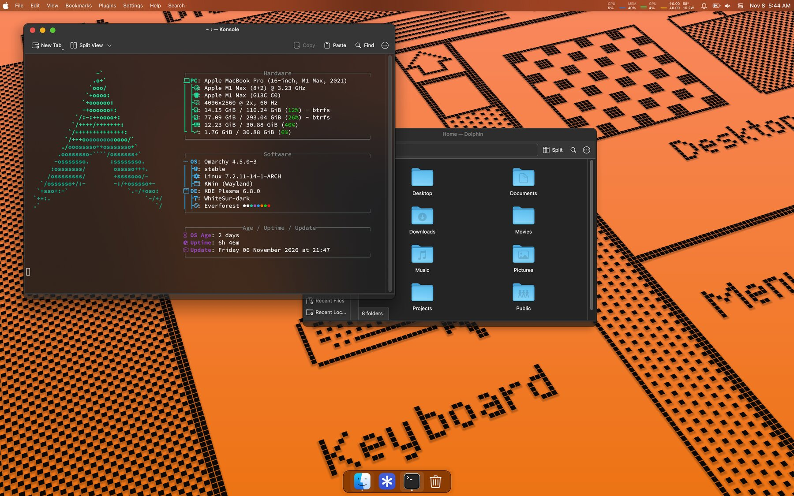
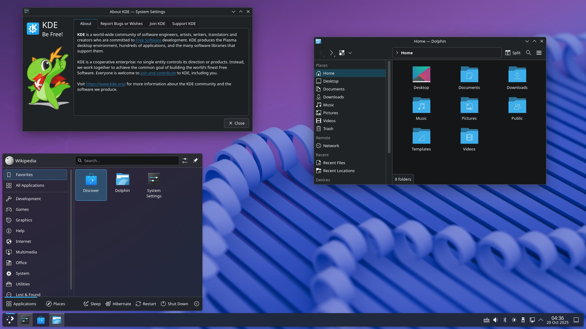
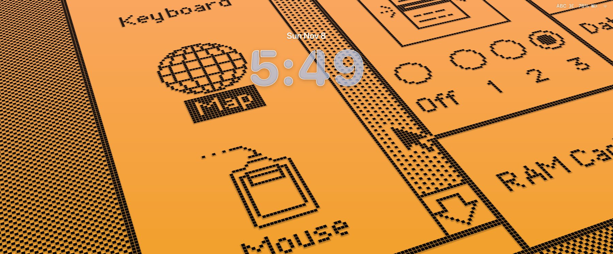
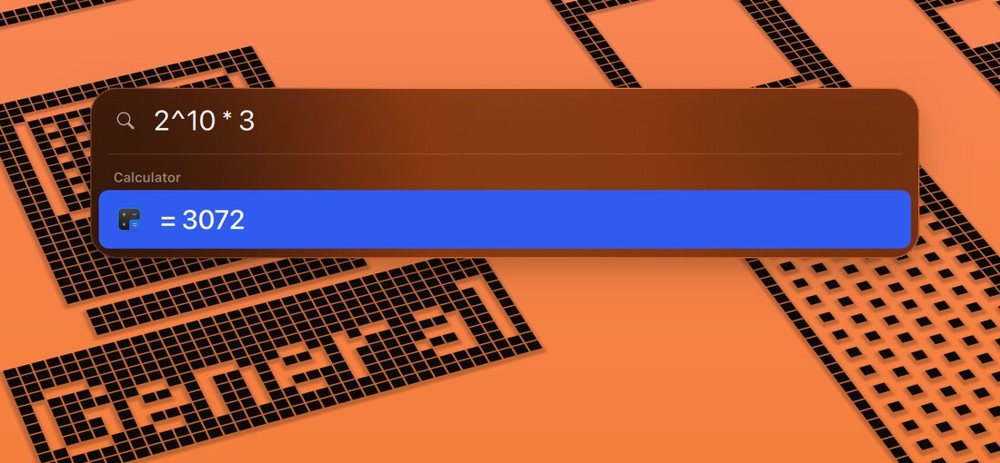
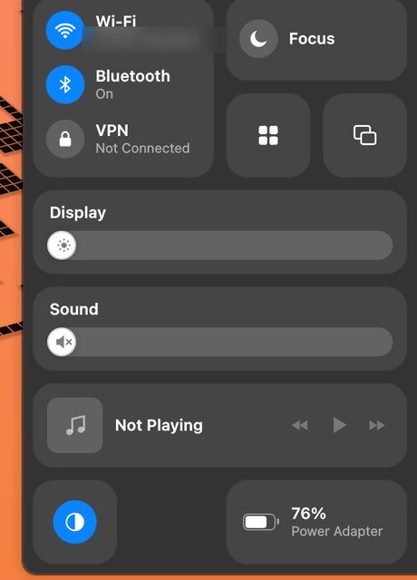
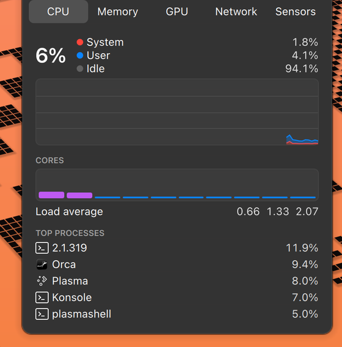

# Fenwyre

<sub>/ˈfɛn.waɪər/ · *fen*: open, untamed land</sub>

**macOS feel, Linux freedom.** A KDE Plasma 6 setup that gets as close to macOS as Linux allows, down to
the menu bar, Spotlight, Control Center, the lock screen and the little things like Cmd+Shift+4.

<p align="center">
  
</p>

## Before and after

| Stock KDE Plasma 6 | Fenwyre |
|---|---|
|  |  |

<sub>Before: "KDE Plasma 6.4.5 Dark" by Michio.kawaii,
[Wikimedia Commons](https://commons.wikimedia.org/wiki/File:KDE_Plasma_6.4.5_Dark.png), GPL.</sub>

## Why

I love macOS: the polish, the shortcuts, the way everything feels considered. What I didn't love was the
lack of freedom, and as a developer who lives in Docker, the VM tax: on macOS every container runs inside
a Linux VM that holds on to gigabytes of RAM whether you need them or not. On Linux, containers are just
processes.

So this repo takes the other road: keep Linux, and rebuild as much of the macOS experience on top of KDE
Plasma as possible. It's built and used daily on a MacBook Pro 16" M1 Max running Asahi Linux
(Omarchy, Arch Linux ARM) with Plasma 6.8 on Wayland, plus an LG 4K, a portrait side monitor, a Logitech
MX Keys and an MX Master 3. Most of it works on any Plasma 6 machine; a few pieces (fans, GPU stats,
battery limit) are Apple silicon specific.

## A closer look

| | |
|---|---|
|  |  |
| **Lock screen**: Liquid Glass clock over the animated wallpaper; each display plays its own animation and the desktop picks up the same frame on unlock. | **Spotlight** on Cmd+Space: apps, settings, calculator, unit and currency conversion. |
|  |  |
| **Control Center**: Wi-Fi, Bluetooth, VPN, Focus, per-screen brightness, sound, Now Playing. | **Mac Stats** (Stats / iStat Menus): CPU, memory, GPU, network and sensors, with per-app CPU, memory, network and GPU. |

## Omarchy users: install KDE Plasma first

Omarchy ships Hyprland. Fenwyre is a **KDE Plasma 6 (Wayland)** setup, so Plasma has to be installed and
running before you apply anything:

```bash
sudo pacman -S plasma-meta dolphin konsole      # Plasma 6 + the file manager and terminal used here
```

Omarchy logs you straight into Hyprland through SDDM autologin. Switch that to Plasma (or remove the
autologin and pick "Plasma (Wayland)" at the login screen):

```ini
# /etc/sddm.conf.d/99-kde.conf
[Autologin]
Session=plasma.desktop
```

Reboot into Plasma, then come back here. Notes from doing this on Omarchy:

- Keep the `omarchy` package installed: Omarchy's Asahi kernel and boot pieces depend on it.
- Keep gnome-keyring as the Secret Service so browsers stay logged in; leave KWallet disabled.
- The `lockscreen` feature hides the Hyprland entries from the login screen (only Plasma is offered).

## What you get

| macOS | Here | How |
|---|---|---|
| Menu bar + Dock | Top panel (Apple logo launcher, global menu, tray, clock) and auto-hiding dock on every screen | Plasma panels |
| Look | WhiteSur Plasma style, icons, cursors, window decoration, SF Pro / SF Mono fonts | WhiteSur (upstream), AUR `apple-fonts`, `config/fontconfig` |
| Light / Dark switch | "macOS Light" / "macOS Dark" global themes that keep the macOS look | `look-and-feel/` |
| Clear menu bar, glass popups | Nearly clear menu bar (35% black veil keeps white text readable on bright wallpapers; Plasma can't switch the bar to dark text the way macOS does); dock, popups and Spotlight share one glass tint; re-applied at every login | `bin/plasma-sync-glass` |
| Menu bar right side | Battery, Sound (speaker or headphones glyph; menu with slider + output list, unplugged outputs hidden), Control Center, "Nov 8  3:04 AM" clock; no tray chevron, no Spotlight icon | `plasma-scripts/mac-layout.js`, `plasmoids/net.local.volume` |
| Cmd shortcuts | Cmd/Ctrl swapped in XKB, so Cmd+C/V/W/Q/Space work | `kxkbrc` |
| Spotlight (Cmd+Space) | Centred translucent search: apps, settings, calculator, unit and currency conversion | `plasmoids/net.local.spotlight` + `qml-blurbehind` |
| Control Center | Wi-Fi, Bluetooth, VPN, Focus/DND, per-screen brightness, volume + output, Now Playing, keyboard backlight, battery mode | `plasmoids/net.local.controlcenter` |
| Stats / iStat Menus | Menu-bar CPU/MEM/GPU sparklines, network Mbps, temp, watts; click for graphs, per-app CPU/memory/network, GPU load/clock/power/memory (Asahi `agx_stats`) | `plasmoids/net.local.macstats`, `bin/mac-stats*`, `system/bin/nethogs-feed` |
| Quick Look (Space) | Space previews in Dolphin and on the desktop, arrow keys move between files, big window | GNOME Sushi + `bin/quicklook`, `bin/sushi-launch`, `bin/desktop-quicklook-patch` |
| Lock screen (26/27) | Macintosh live wallpaper animates behind a Liquid Glass stencil clock (date above, no AM/PM), password pill appears on input; on unlock the desktop wallpaper continues from the same frame and eases to a stop over ~5 s | `lockscreen/`, `qml-lockwatch/`, `systemd/user/plasma-kwin_wayland.service.d/`, `wallpapers/net.local.macintosh` |
| Volume / brightness HUD (27.2) | Clear Liquid Glass capsule under the menu bar, top right, outlined glyph (headphones when they're the output), thin 16-segment bar | `osd/` (+ `qml-blurbehind`) |
| Screenshots | Cmd+Shift+3 / 4 / 5 to the Desktop, add Ctrl for clipboard | `config/applications/mac-shot-*` + kglobalaccel |
| BetterDisplay brightness | Brightness keys change only the display under the mouse (DDC/CI on externals); the built-in panel steps 2.5% in perceived lightness (CIE L*), like macOS, instead of linear nits | `bin/brightness-here*` |
| DDC/CI on Apple Silicon | External monitors on the Mac's own ports get a real DDC bus (`ddcutil`, PowerDevil): the patched display driver carries I2C over the DCP firmware, the way macOS's `IOAVServiceReadI2C`/`WriteI2C` do. The built-in HDMI display also comes back after sleep without a replug | `system/display/` (`appledrm` unit) |
| AlDente | Battery charge limit (default 80%) that survives reboots; above the limit it discharges while plugged in (Asahi `auto-discharge`) | `system/bin/battery-limit` |
| ProMotion | Adaptive refresh (VRR "Always") on the built-in display | `install.sh` (`vrr` unit) |
| SSD TRIM (macOS does it automatically) | Discards pass through the encrypted root (`rd.luks.options=<uuid>=discard`, Limine), btrfs `discard=async`, weekly fstrim | `install.sh` (`trim` unit) |
| Bluetooth audio | LDAC adaptive: backs off on radio dips instead of skipping (`hq` = locked 990 kbps, fuller but skips on a weak link) | `config/wireplumber/52-bluez-ldac.conf` |
| Sony Clear Bass on LDAC | WH-1000XM3 ignores its own EQ on LDAC, so PipeWire applies a Clear Bass-style tune (−6 dB preamp, +6 dB low shelf at 120 Hz) as a smart filter in front of the headset only; hidden from output lists | `config/pipewire/60-sony-clearbass.conf` (edit `filter.smart.target` for your headset's `bluez_output.<MAC>.1`) |
| Helium video (Apple silicon) | Hardware VA-API decode for H.264/VP9; an extension hides AV1 (no AV1 decoder on M1/M2) so YouTube uses hardware | `config/helium/` |
| MX Keys in Mac mode | Logitech keyboards switched to macOS layout on every connect; the lock key (Ctrl+Cmd+Q) locks the screen | `bin/logi-macmode` (Solaar) |
| Windows reopen where you left them | KWin "remember" rules per app | AGENTS.md step 9 |
| Terminal | Konsole "Mac" profile, translucent dark scheme, Source Code Pro for Powerline | `config/konsole` |
| Macintosh live wallpaper (Sequoia) | Susan Kare 1-bit scenes as tilted coloured pixel tiles that zoom, scroll and animate; Spectrum and 10 other colours; 10 scenes | `wallpapers/net.local.macintosh` |
| Aerial wallpaper | Apple aerial videos via Smart Video Wallpaper Reborn | AGENTS.md step 11 |

## Not possible (and why)

- **XDR / HDR brightness boost**: the Asahi display driver tops out at 500 nits SDR and has no HDR.
- **Real AirDrop**: no Apple protocol support; KDE Connect is the nearest thing.
- **Focus modes other than Do Not Disturb**: no Linux equivalent.
- **Reading Apple's own wallpaper bundles from the macOS partition**: Apple silicon volumes are
  hardware-encrypted; apfs-fuse fails at KeyManager.
- **Restyling KRunner**: its UI is compiled into the binary, so Spotlight is a separate widget on
  KRunner's engine (Milou).

## Install

```bash
git clone https://github.com/ankurpandeyvns/fenwyre.git && cd fenwyre
```

Pick what you want; nothing is all-or-nothing. Everything is user-level except a few small root services,
it's idempotent, and it backs up what it touches to `~/kde-pre-mac-backup/`.

```bash
./install.sh features              # the 16 features: id|group|title|description|sudo
./install.sh plan menubar hud      # what would run (and whether sudo is needed); changes nothing
./install.sh apply menubar hud     # apply only those
./install.sh apply all             # everything
./install.sh deps                  # pacman packages (sudo)
```

With an agent (Claude Code, Codex, ...): open this repo and ask it to follow [AGENTS.md](AGENTS.md). Its first
step asks you, with a multiple-choice prompt, whether to apply everything or which features, then applies and
verifies only those. Then the manual steps in AGENTS.md (WhiteSur theme, fonts, panel order, window rules).
The traps that cost hours the first time are written up in [docs/LESSONS.md](docs/LESSONS.md).

## Layout

```
bin/                user helpers (installed to ~/.local/bin)
systemd/user/       user services for those helpers
system/             root helpers + units (battery-limit, nethogs-feed, gpu-feed, mac-fand, fan driver patch, SDDM)
plasmoids/          Spotlight, Control Center, Mac Stats widgets
wallpapers/         Macintosh live wallpaper (interprets Apple's .program scene scripts)
look-and-feel/      macOS Light / macOS Dark global themes
osd/                replacement Plasma OSD (Osd.qml), shadowing the system module
qml-blurbehind/     tiny C++ QML plugin: ask KWin to blur behind a QML item
plasma-scripts/     Plasma scripting snippets (panel widgets, tray, launcher icon)
config/             launchers, D-Bus services, Dolphin service menu, Konsole, fontconfig, KRunner plugins
docs/LESSONS.md     traps and how they were solved
docs/images/        README screenshots
```

## Credits

- **Macintosh wallpaper**: pixel art by Susan Kare for Apple, and two of Apple's scene scripts from macOS Sequoia,
  via Stephen Hackett's [512 Pixels](https://512pixels.net/2025/06/inside-macintosh-screen-saver/). Details in
  [wallpapers/net.local.macintosh/SOURCES.md](wallpapers/net.local.macintosh/SOURCES.md).
- **Theme**: [WhiteSur](https://github.com/vinceliuice/WhiteSur-kde) by vinceliuice (installed from upstream, not bundled).
- **Fonts**: SF Pro / SF Mono from the AUR `apple-fonts` package (not bundled); Source Code Pro for Powerline.
- **Lock screen**: based on Plasma's Breeze lock screen (GPL); fan driver patch on Asahi's `macsmc-hwmon` (GPL).
- **Before screenshot**: Michio.kawaii, Wikimedia Commons, GPL.

Fenwyre is an independent project, not affiliated with or endorsed by Apple Inc. macOS, Macintosh, Spotlight
and the Apple logo are trademarks of Apple Inc.

Files containing `@HOME@` are templates; the installer substitutes your home directory.
